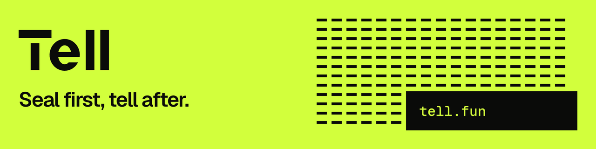

  

  
  
  
  
  
  
  

# Tell

Seal first, tell after. The place in line of a sealed order is fixed first, and the order opens only afterwards.

Tell is its own network, built from Solana's engine Agave. It is not on Solana mainnet. A user sends only the fingerprint of an order; the chain gives that fingerprint a place in line; once the place is fixed, the user opens the order; execution follows the line. When the place is fixed, the only one who knows the content is the sender: not the validators, not the project.

There is no key committee and no secure chip. The sender seals and the sender opens, and the wallet in the browser does both for one press. The exact claim is narrow on purpose: an order sent through an envelope cannot be read by anyone before its place in line is final. To cut in, a party must commit blind and post a bond.

## How a sealed order runs

1. **Seal.** The wallet sends the fingerprint (a hash of the order and a secret), a public cap on the order's size and a bond. The envelope program gives it the next place in line.
2. **Open.** In the open window, a fixed number of slots after the sealing slot set per line (12 on the main SLAB/TEST pair), the wallet sends the content and the secret. The program checks them against the fingerprint.
3. **Execute.** When the window of a batch has ended, opened orders run in line order through the sealed pool, and an order that fills gets its bond back.
4. **Skip.** An envelope that is not opened is skipped and its bond is burned.
5. **Check.** Anyone can read the blocks with the stock Solana CLI: an order shows only a fingerprint until its place is fixed, then opens, then executes in line.

## The network

- Four programs are in the chain's genesis with no upgrade authority: the envelope program, the sealed pool, the open pool and the auction program.
- The sealed pool cannot be called from outside the envelope program. The open pool is an ordinary constant-product pool, kept beside it for comparison.
- All four validators are run by the project.
- The chain runs on faucet test money today. No coin on it is real money.

The four programs on the Tell chain, each with no upgrade authority:

| Program | Address |
|---|---|
| Envelope program | `jkhaCtRjHFmw1E6fZVL3MdR2dBjka1Rh1cEufFE5mGF`  |
| Sealed pool | `D1nuiLpfLrhm5qbMaLUdb2cLaAYWgCPDEXWaw2KE4Un7`  |
| Open pool | `HxzVrsgrfeYXmdjT5cxsZBaj6z4WdQMqQjTp8Z7EN957`  |
| Sealed auction | `CWvRXgP4d9QGZFEt1DBEBnpECtUEW5F1hRD1QKbZ5YMH`  |

## What the comparison measures

The open pool and the sealed pool use the same constant-product pricing. In the open pool, the direction and size of an order are visible before execution. In the sealed pool, a commitment gets its place first. The comparison uses project-operated accounts and faucet tokens.
